<div align="center">

# Visual Intelligence Engine

**Search photos and videos by what is in them.**<br>
Faces, animals, food, plain-English descriptions, and moments inside a video, all from one index.

[](https://github.com/ParsaVictor/visual-intelligence-engine/actions/workflows/ci.yml)
[](https://github.com/ParsaVictor/visual-intelligence-engine/actions/workflows/models.yml)
[](https://www.python.org/)
[](CHANGELOG.md)

<div dir="rtl">

جستجو در عکس و ویدیو بر اساس محتوا: چهره، حیوان، غذا، توضیح متنی و لحظه‌های داخل ویدیو.

</div>

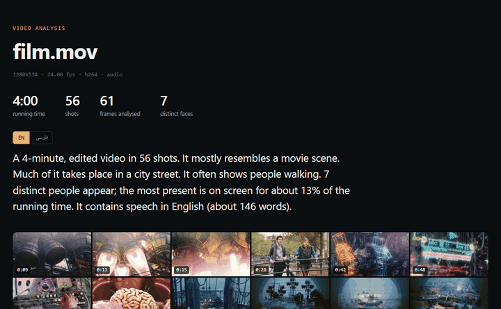

<sub><code>vie video analyze</code> on four minutes of <i>Tears of Steel</i> (© Blender Foundation, CC BY 3.0)</sub>

</div>

## What you can ask

| Ask with | Example | You get |
|:--|:--|:--|
| A face | `vie search face --image a.jpg --image b.jpg` | Every photo of that person; more photos find more |
| An animal | `vie search animal --query "red panda"` | Photos with the animal boxed |
| A dish | `vie search food --query "ghormeh sabzi"` | Photos of it, even with no detector class for it |
| A description | `vie search text --query "a man with a blue backpack"` | The closest matches |
| A concept, everywhere | `Engine.search_everything("a theatre performance")` | Photos and video moments together, ranked on one scale |
| A video | `vie video analyze clip.mp4 --html report.html` | Shots, topics, people, speech and a summary |
| An annotated video | `Engine.render_video(...)` | An MP4 with every face tracked, named or grouped, on a timeline |
| A moment | `vie video search --query "a goal being scored"` | Timestamps across all your videos |

## See it work

<div align="center">

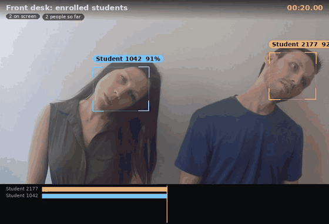

<sub>Named from three reference photos each, taken from <i>other</i> recordings. Corridor and classroom: [MP4](assets/showcase/corridor_people.mp4) · [MP4](assets/showcase/classroom_people.mp4)</sub>

</div>

| Face search with two query photos | Every face in a classroom, grouped |
|:--|:--|
| 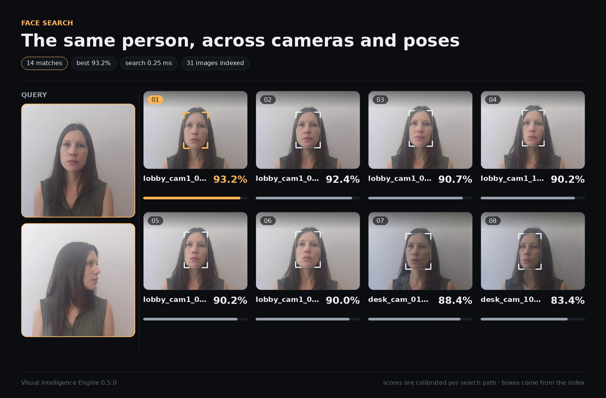 | 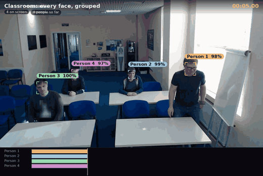 |
| **Who was in the video, and for how long** | **Corridor camera** |
| 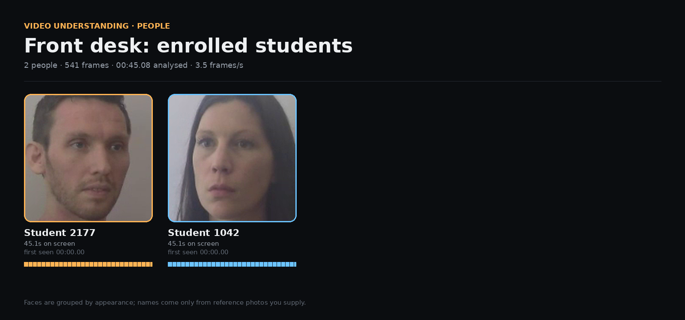 | 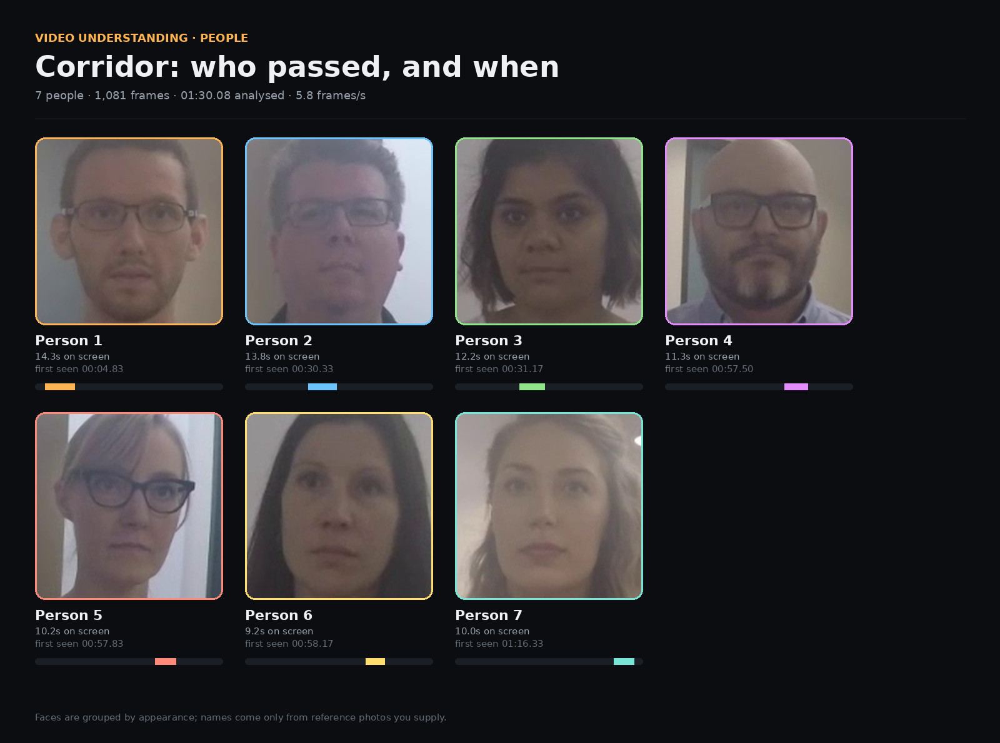 |

<sub>Real output of the current code, regenerated by <a href="scripts/make_showcase.py"><code>scripts/make_showcase.py</code></a>. Footage: <a href="https://github.com/intel-iot-devkit/sample-videos">intel-iot-devkit/sample-videos</a>, CC BY 4.0.</sub>

<details><summary>Screenshots from the original notebooks</summary>

| Face search | Species search |
|:--|:--|
| 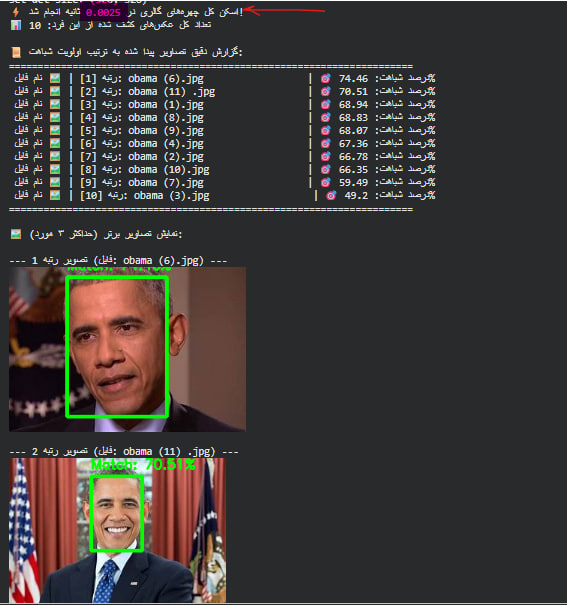 | 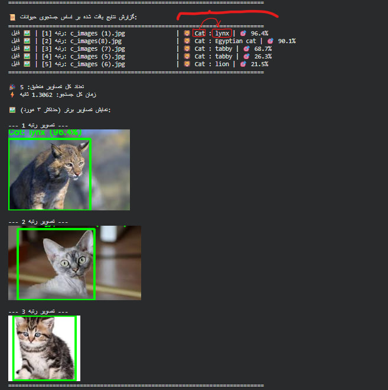 |
| **Food search** | **Free-text search** |
| 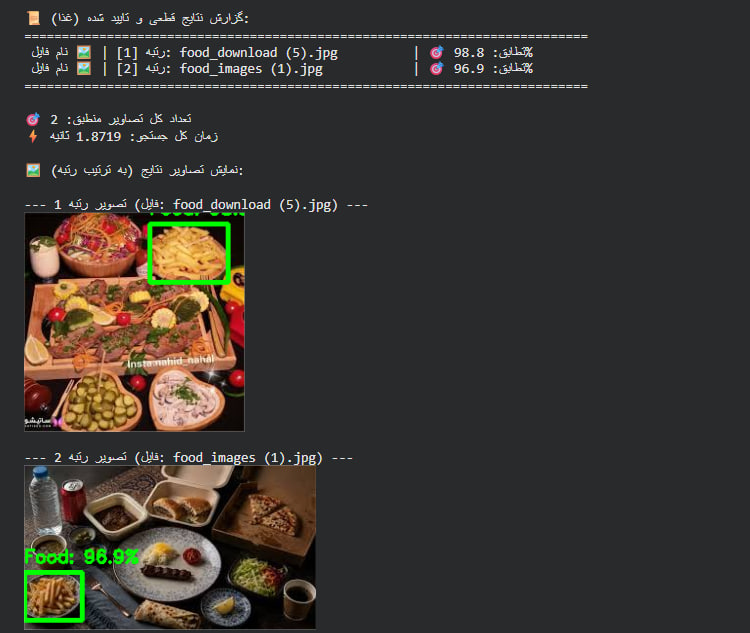 | 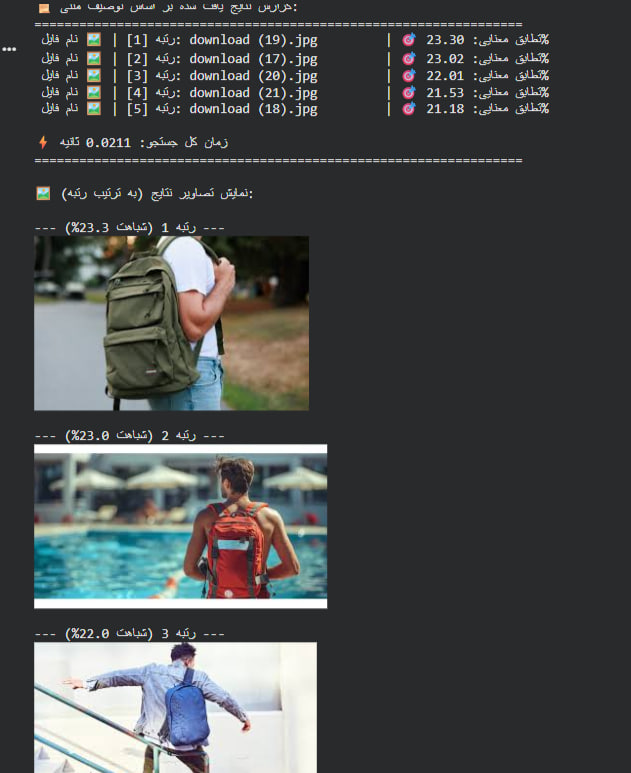 |

</details>

## Run everything in Colab

[](https://colab.research.google.com/github/ParsaVictor/visual-intelligence-engine/blob/main/notebooks/0_run_everything.ipynb)

[`notebooks/0_run_everything.ipynb`](notebooks/0_run_everything.ipynb) runs the whole system with one *Run all*: index, all four searches, video analysis, annotated output videos and presentation cards. The index lives on Google Drive, so **the first run reads the whole dataset and every later run reads only new or changed files**. Measured in the notebook itself on a 4-core CPU: indexing 37 photos took 18.4 s, and after one more photo was added the next run took 1.1 s; two videos took 67.8 s to analyse the first time and 0.0 s the next.

## Architecture

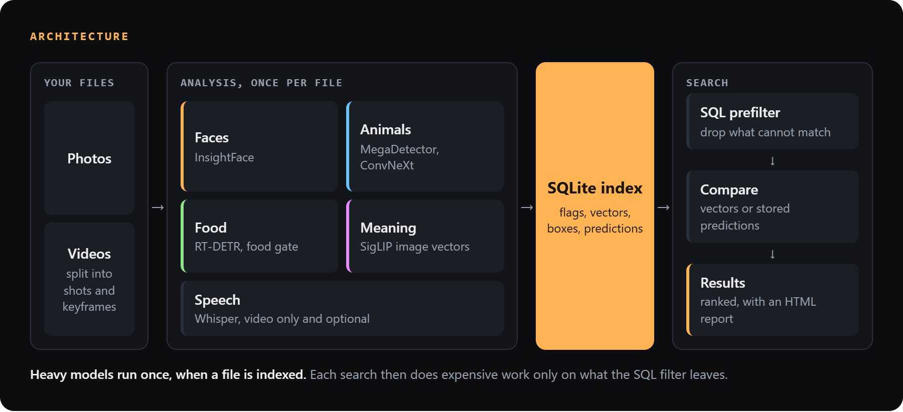

Three decisions carry most of the design:

- **Index once, query cheaply.** A species the classifier knows is answered from stored predictions, with no model loaded at all. Every detected animal and dish also has its vector stored, so a food query or an unknown species is a matrix product, not a pass over the pixels.
- **Ask against rivals.** Instead of thresholding a raw similarity, each query competes with prompts like "a different kind of animal", which gives the model a way to say no.
- **Measure, then decide.** Thresholds and the search backend come from measurements on real data, including where they overturned the original assumptions.

More in [the architecture](docs/architecture.md), [the design decisions](docs/design-decisions.md) and [the video pipeline](docs/video.md).

## How the project got here

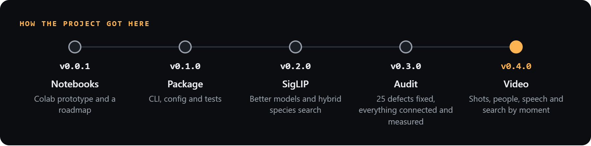

| Step | What changed |
|:--|:--|
| **Fix what was wrong** | Species mapping, cross-checks that never ran, drifting thresholds |
| **Build a real package** | CLI, one config file, a database with migrations |
| **Upgrade the models** | CLIP to SigLIP, a stronger classifier, multi-crop search |
| **[Audit it honestly](docs/AUDIT.md)** | Found 25 defects behind 198 green tests, then fixed them all |
| **Test with real weights** | End-to-end tests, plus a CI job running every real model |
| **Understand video** | Shots, people, speech, timelines and search by moment |
| **One engine** | Measured face upgrade, annotated output video, one-click Colab notebook |
| **Search everything** | Concepts across photos and videos, Persian queries, food and species from stored vectors |

Next up: on-screen text search, natural-language summaries and a REST API. See the [roadmap](ROADMAP.md) and [changelog](CHANGELOG.md).

## Quick start

```bash
git clone https://github.com/ParsaVictor/visual-intelligence-engine.git
cd visual-intelligence-engine
python -m venv .venv && source .venv/bin/activate   # Windows: .venv\Scripts\activate

pip install -e ".[models,gpu,video,speech,demo]"    # no GPU? use "cpu" instead of "gpu"
```

Put photos in `data/gallery/` and videos in `data/videos/`, then:

```bash
vie doctor            # is this machine ready?
vie index             # index the photos
vie video index       # index the videos
python -m vie.demo    # open the web demo
```

Every search also takes `--json` for scripts and `--html report.html` for a shareable page.

**On a small machine,** set `google/siglip-base-patch16-224` and `runtime.low_memory: true` in [the config](src/vie/default.yaml), and use `--labels-only` for video. A fast GPU is recommended for large archives.

## Measured

**Faces.** ArcFace (this repo) against SFace (the recogniser in
[student-face-gate](https://github.com/ParsaVictor/student-face-gate)), on identical aligned crops:
776 faces, 17,956 same-person pairs (3,716 with a head turn of 30° or more) and 18,472
different-person pairs. Each model at the threshold its own project ships with.

| Recogniser | Equal error rate | Separation d′ | Same person accepted | Hard poses accepted | Wrong person accepted |
|:--|--:|--:|--:|--:|--:|
| **ArcFace + mirror (default)** | **0.0%** | **8.43** | **98.9%** | **97.6%** | **0** |
| ArcFace | 0.0% | 8.08 | 98.6% | 96.9% | 0 |
| SFace + mirror | 0.21% | 6.07 | 91.2% | 86.9% | 0 |
| SFace | 0.20% | 5.86 | 89.8% | 83.6% | 0 |

ArcFace separates people about 40% more widely, so it stays the recogniser. From the gate
come two measured ideas: averaging each face with its mirror image (now on by default) and
searching with several photos of a person. This is a pose stress test on public footage, not
LFW; reproduce it with [`scripts/face_benchmark.py`](scripts/face_benchmark.py), results in
[`results/face_benchmark.json`](results/face_benchmark.json).

**Typed search, SigLIP vs SigLIP 2** (`scripts/eval_search.py` in the *Search quality*
workflow, real weights, 14 labelled queries over 92 public photos):

| | SigLIP so400m | **SigLIP 2 so400m (default)** |
|:--|--:|--:|
| English query, mAP | 1.000 | 1.000 |
| Persian query, mAP | 0.738 | **0.945** |
| Food precision / recall, at each model's thresholds | 0.89 / 1.00 | 0.90–0.94 / 0.98–1.00 |
| Unknown-species precision / recall | 0.95 / 1.00 | 0.95 / 0.95–1.00 |
| Best right image of a present concept, calibrated probability (worst case) | 0.023 | 0.009 |
| Best image of an absent concept (median of 8) | 0.00002 | 0.00001 |

The last two rows set `text.min_probability: 0.001`: a concept that is not in the archive
returns nothing rather than its least-bad five. SigLIP 2 ranges are over two calibration
runs whose samples differed slightly (44 and 48 dish images): on food and species the two
models are level within that noise, and Persian is where SigLIP 2 is clearly ahead. The English set is too easy to separate the
models or to show what averaging phrasings adds; both score 1.0 either way. Results in
[`results/search_eval.json`](results/search_eval.json).

**Species and food.** Precision on 72 public labelled images with the default model, at 100% recall. The set is small and easy, so read this as a comparison between versions, not as expected accuracy on your archive.

| Search | v0.2 | Now |
|:--|--:|--:|
| Species | 57% | **94%** |
| Food | 46% | **92%** |

Vector search over 100,000 vectors on 4 CPU cores takes **10 ms**, and returns the exact answer.

Not yet measured: accuracy on a real archive, and anything on a GPU. Reproduce the numbers above with [`scripts/calibrate.py`](scripts/calibrate.py) and [`scripts/benchmark.py`](scripts/benchmark.py).

## Privacy

This system stores **biometric identifiers of identifiable people**. Photos, footage, the index and generated reports are blocked from version control, and reports and the demo call no third party. If you deploy it, you need a lawful basis for processing those images. See [SECURITY.md](SECURITY.md).

## Built with

[SigLIP](https://github.com/google-research/big_vision) · [InsightFace](https://github.com/deepinsight/insightface) · [MegaDetector](https://github.com/agentmorris/MegaDetector) · [Ultralytics](https://github.com/ultralytics/ultralytics) · [faster-whisper](https://github.com/SYSTRAN/faster-whisper) · [PyAV](https://github.com/PyAV-Org/PyAV)

## License

Not yet chosen, so no reuse rights are granted for now. Each model above has its own licence.
