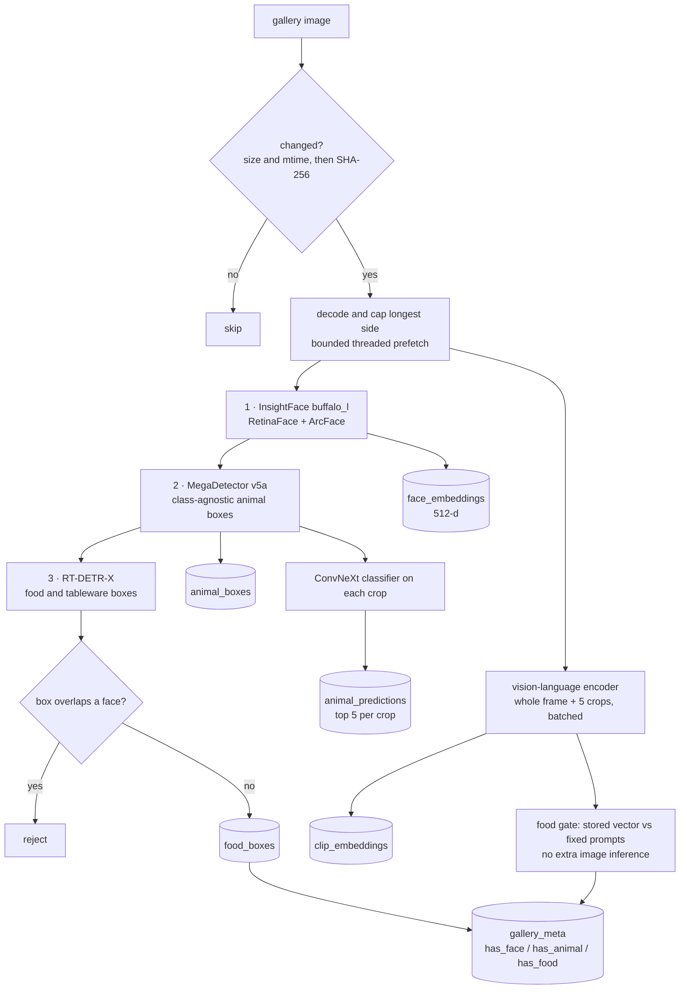
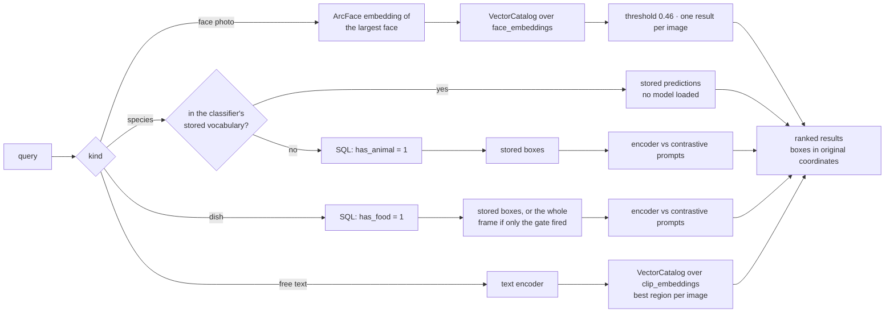

# Architecture

Two phases: heavy models run **once per image at index time**, queries run only
over what the index already knows.

> **On the original diagram.** `docs/architecture-original.png` is kept for
> history, but it claimed four things the code never did: a FAISS index (there
> was a plain NumPy loop, and no faiss import anywhere), a "120-species
> dictionary" (there were 8 keyword buckets — the number 120 came from a comment
> about ImageNet's 120 *dog breeds*), MobileNetV3 running at index time (it ran
> only at query time), and stored MegaDetector crops (nothing was stored). FP16
> was also listed as a global optimisation when only CLIP was ever half
> precision. The diagrams below describe what the code actually does.

## Indexing



Everything written for one image is one transaction, and a batch that fails is retried
image by image.

**Stage order is load-bearing.** Faces must be detected before food, because the
food stage rejects boxes that sit on a face. The original ran animal → food →
face, so that guard read variables that had not been assigned yet and was always
false. `vie.indexing.STAGE_ORDER` is asserted by test.

## Querying



Models load on first use, so each path pays only for what it touches.

## The prefilter

The single most important design decision. Each image carries three booleans, so
a species query never touches an image with no animal in it:

```sql
SELECT file_name, file_path FROM gallery_meta WHERE has_animal = 1;
```

The flags come from *class-agnostic* detectors and a generic food gate, which is what
makes them durable: MegaDetector answers "is there an animal", not "which species".

## Models

| Model | Stage | Precision | Output |
|:--|:--|:--|:--|
| InsightFace `buffalo_l` | index + face query | FP32 (ONNX) | 512-d unit vector |
| MegaDetector v5a | index | FP32 | boxes, class 0 = animal |
| RT-DETR-X | index | FP32 | boxes, COCO classes |
| ConvNeXt Tiny | index | FP32 | ImageNet top 5 per animal crop |
| SigLIP so400m (default) | index + 3 query paths | FP16 on CUDA | 1152-d unit vector |

None are fine-tuned. The engineering is in the combination, the index and the
decision rules, not in training.

## Schema

Version 3. Older indexes are upgraded in place; a newer one is refused.

```sql
schema_meta(key PK, value)      -- version, embedding model, classifier vocabulary
gallery_meta(file_name PK, file_path, content_hash, file_size, mtime_ns, index_scale,
             has_face, has_animal, has_food,
             food_by_detector, food_by_vlm, food_vlm_score)
face_embeddings(file_name, bbox, embedding, PK (file_name, bbox))
clip_embeddings(file_name, region, embedding, PK (file_name, region))
animal_boxes(file_name, bbox, confidence, PK (file_name, bbox))
animal_predictions(file_name, bbox, class_id, probability, PK (file_name, bbox, class_id))
food_boxes(file_name, bbox, confidence, class_id, PK (file_name, bbox))
```

`file_name` is the gallery-relative path. For a flat gallery that is the bare name older
versions stored, so existing rows stay valid.
<!-- video-start -->

Video adds `videos`, `video_keyframes`, `video_faces` and `video_transcript` to the same
file. See [video.md](video.md).
<!-- video-end -->
