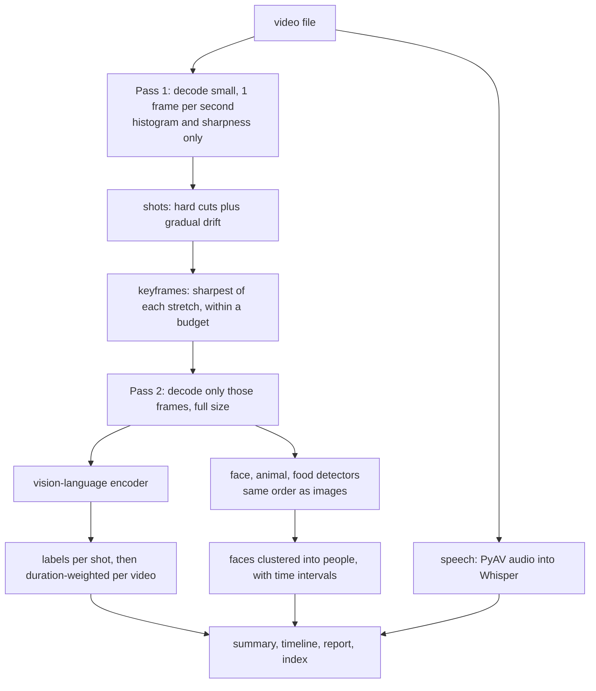

# Video understanding

Answers two questions: **what is in this video**, and **where in my videos is this**.

```bash
pip install -e ".[models,cpu,video,speech]"

vie video analyze clip.mp4 --html report.html     # one file, full report
vie video analyze clip.mp4 --labels-only          # vision-language model only: laptop CPU
vie video analyze clip.mp4 --transcribe           # add speech
vie video index                                   # every file in paths.videos
vie video search --query "a goal being scored"    # moments, across all videos
vie video search --image person.jpg               # when this person appears
```

## How it works



**Two passes keep memory flat.** The first pass keeps no pixels, so a long film costs
the same as a short clip until keyframes are chosen.

**Duration is what gets weighed, not frame count.** A five-second title card with six
sharp keyframes must not outvote a two-minute interview that received three.

**A person is a cluster, not an identity.** Faces are grouped by similarity within a
video. Nothing assigns a name. Naming someone takes a deliberate search with a photo
the operator supplies.

**Every sentence in a summary traces to a measurement.** How strongly a label is
stated follows how much of the video it covers, labels under 10% get no sentence, and
a stage that did not run says nothing. These rules exist because earlier output said
"most of it takes place in the mountains" about 13% of a video, and "no faces were
detected" with the face stage switched off.

## What was tested, and on what

The logic is covered by real encoded video files with cuts at known times: only the
weights are faked in `tests/test_video.py`.

Real models, real footage, on a 4 GB laptop CPU with `google/siglip-base-patch16-224`:

| Footage | Result | Time |
|:--|:--|--:|
| *Sintel* trailer, 52 s, animated | 29 shots, 29 keyframes | about 2 min |
| *Tears of Steel*, first 4 min, live action with dialogue | 56 shots, 61 keyframes, 27 speech segments | about 6 min |

The film was summarised as resembling "a movie scene", and Whisper `tiny` transcribed
its dialogue well enough to read.

**Label quality is honest but limited.** Zero-shot labels from a fixed list are noisy
per shot: rocket engines came back as "people cooking". Rolled up over a whole video
they were sensible, which is why the summary only speaks at that level. Shot-level tags
in the report are model output, and the report says so. No accuracy figure is claimed,
because none has been measured against ground truth.

With every stage on, in `.github/workflows/models.yml` on 4 vCPU and 16 GB, the same four
minutes gave 7 distinct people, about 25 speech segments in English, no animals (correct) and
no stage failures. That shows the stack runs on real footage. It does not measure how well
it clusters people, since nothing here has ground truth for that.

## What could come next

In rough order of value for effort:

| Addition | What it gives | Cost |
|:--|:--|:--|
| Language-model summary over the measured facts | A natural paragraph, grounded in the timeline and transcript | An API or local model |
| OCR on keyframes | Titles, captions and on-screen names become searchable: huge for news | Small model |
| Speech embedding search | Find by meaning rather than exact words | Small |
| Temporal action model (VideoMAE, X-CLIP) | Real actions rather than per-frame guesses | GPU |
| A video-native vision model (SmolVLM2, Qwen2.5-VL) | Rich per-shot descriptions | GPU |
| Audio event detection (PANNs, BEATs) | Applause, music, gunfire | Small model |
| Face tracking across frames | Fewer identity splits, smoother intervals | Moderate |
